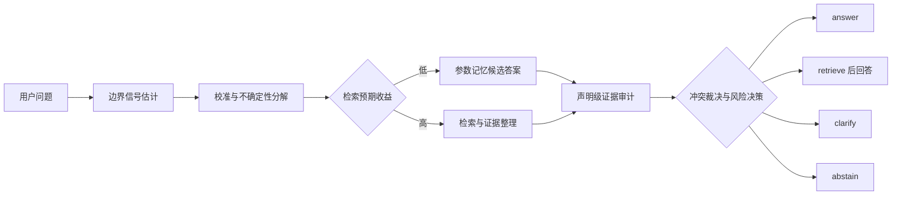

# Calibrated Self-Knowledge Gating for Adaptive Retrieval and Abstention in LLM Systems

中文课题：**模型自我知识边界驱动的自适应检索、拒答与冲突裁决**

> 核心思想：不要让模型每次都 RAG，也不要让模型裸答。系统先判断“我是否知道、是否有权访问、知识是否可能过期、证据是否充分、参数记忆与外部证据是否冲突”，再选择 `answer / retrieve / clarify / abstain`。

这是一个完整的研究项目代码仓库。研究问题、数据契约、实验流程、机制文献和实现边界统一记录在本文件中；实际数据、模型权重、向量索引和运行产物不进入 Git。

## 1. 项目目标

本项目研究一个经过校准的自我知识门控器，让 LLM 在参数记忆、外部检索和拒答之间做出可审计的选择。核心目标不是追求单点 accuracy，而是回答以下问题：

1. LLM 能否可靠区分 `parametric_known / uncertain / no_access / stale` 四类知识边界？
2. 在相同检索调用数、上下文 token 和 p95 时延下，边界信号门控能否优于 `always-answer`、`always-RAG` 和单一置信度路由？
3. 参数记忆与检索证据冲突时，显式的 claim-level conflict adjudication 是否优于固定信任参数、固定信任检索或多数规则？
4. 高风险场景中，带 `reason_code` 的拒答能否降低错误答案与权限泄露，同时不过度拒答？

主要产出是 coverage-risk-cost-latency 的 **Pareto frontier**，而不是一个孤立的最佳准确率。

## 2. 四类知识边界

边界状态是模型、数据版本和访问权限共同决定的条件状态，不是问题本身永远固定的标签。

| 状态 | 定义 | 典型处理 |
| --- | --- | --- |
| `parametric_known` | 当前模型参数中有可用知识，闭卷答案通过确定性评测，且与当前权威版本一致 | `answer` |
| `uncertain` | 问题可回答且来源可访问，但答案或自我评估不稳定、未校准或语义熵较高 | `retrieve`、`clarify` 或 `abstain` |
| `no_access` | 可靠答案只存在于未提供、私有或权限拒绝的来源 | `abstain`，不得猜测隐藏值 |
| `stale` | 参数记忆或证据来自旧版本，与当前权威来源发生时间冲突 | `retrieve` 或 `abstain` |

`parametric_known` 与 `uncertain` 的判定阈值只在校准集上拟合，并在测试集前冻结。模型 checkpoint、数据快照、访问策略和阈值必须写入运行记录。

## 3. 决策契约

每次请求都输出一个动作、边界概率、可审计信号、证据来源和理由。

| 动作 | 触发条件 | 最小输出 |
| --- | --- | --- |
| `answer` | 参数记忆可信，问题可回答，证据要求已满足 | 回答、置信度、依据 |
| `retrieve` | 自我知识不足、知识可能过时或检索预期收益为正 | 查询、证据、基于证据的回答 |
| `clarify` | 关键歧义会改变答案，缺少约束 | 一个最小澄清问题 |
| `abstain` | 可回答性低、权限不足、冲突未解决或风险超过阈值 | 安全理由、缺失信息、下一步建议 |

至少记录以下信号：

- `boundary_probs`：四类边界状态的校准概率；
- `self_knowledge`：模型对自己是否掌握答案的估计；
- `answerability`：在当前访问策略下产生受支持答案的可能性；
- `evidence_sufficiency`：证据的相关性、覆盖度、来源可靠性和新鲜度；
- `conflict_score`：参数记忆、检索证据和多来源证据之间的不一致程度；
- `retrieval_utility`：预期证据收益减去 token、调用、时延和噪声成本；
- `reason_code`：面向用户的安全决策原因，不披露被保护内容。

推荐的拒答原因码：

```text
AMBIGUOUS_QUESTION
INSUFFICIENT_EVIDENCE
PARAMETRIC_UNCERTAINTY
STALE_PARAMETRIC_MEMORY
CONFLICT_UNRESOLVED
NO_AUTHORIZED_SOURCE
HIGH_RISK_UNSUPPORTED
```

## 4. 系统流程



冲突裁决不能静默覆盖证据。系统保留声明、来源、时间、新鲜度、可靠性、蕴含/矛盾关系和裁决理由；高风险冲突无法解决时，必须进入 `clarify` 或 `abstain`。

## 5. 机制假设

- **H1：边界因子可分解。** `P(True)`、`P(IK)`、语义熵、采样一致性和检索分数分别反映回答正确性、参数知识、自洽性和证据质量，不能压成一个置信度。
- **H2：自适应检索改变前沿。** 校准门控器可以在相同资源预算下减少不必要检索，并保持更低的选择性风险。
- **H3：证据利用是独立瓶颈。** Oracle retrieval 仍可能因忽略证据、数值抄写错误、上下文位置或过度概括而失败。
- **H4：冲突行为受先验重叠影响。** 模型可能出现确认偏差、可得性偏差和多数规则；显式声明级裁决应降低这种不对称。
- **H5：拒答是选择性决策。** 统一阈值容易在权限拒绝场景泄露、在干净样本上过度拒答；reason-coded 策略应改善条件风险-覆盖率前沿。

## 5.1 可解释性机制分析计划

可解释性是本项目的主线。RAG、拒答和冲突裁决是干预环境，用来观察知识边界信号如何形成、如何影响决策，以及局部信号是否最终改善系统可靠性。研究不把一个高 AUROC 的 probe 直接当作机制解释，而是要求完成“预测、定位、干预、系统验证”四步。

### 五级分析框架

| 层级 | 观察/方法 | 要回答的问题 | 最低验证 |
| --- | --- | --- | --- |
| 信号层 | `P(IK)`、`P(True)`、semantic entropy、sampling consistency、log probability | 哪些信号能预测正确性、幻觉和检索收益？ | AUROC、ECE、Brier、slice calibration、OOD |
| 表示层 | hidden states、attention、layer/token probe、Tuned Lens | 不确定性和边界信息在哪些层、token 和表示方向形成？ | 跨层、跨任务、跨模型 probe transfer |
| 因果层 | activation patching、layer/neuron ablation、steering、counterfactual intervention | 改变该表示是否会改变 known/uncertain、检索和拒答行为？ | intervention effect、方向翻转、控制变量实验 |
| 训练动态层 | gradient norm、gradient cosine、update direction、Fisher/参数重要性、loss/gradient variance | 微调和校准如何改变边界信号，哪些更新造成泛化或退化？ | seed=42 训练轨迹、更新前后信号和 OOD 对比 |
| 系统层 | gate、retrieval、reranker、evidence verifier、conflict adjudicator、LLM 输出 | 局部信号是否改善 coverage-risk-cost-latency frontier？ | 四组合、预算匹配、失败归因和 Pareto frontier |

第一阶段的可复现实验入口：

```powershell
python scripts/build_boundary_benchmark.py `
  --config configs/interpretability_probe.yaml

python scripts/run_e2e.py --n 1200 --corpus 8000 `
  --boundary-benchmark data/processed/boundary_benchmark_seed42.jsonl `
  --routing-baseline calibrated-boundary-gate `
  --conflict-baseline claim-level `
  --run-id boundary-probes-seed42

python scripts/analyze_probe_runs.py `
  --run-dir results/runs/boundary-probes-seed42 `
  --benchmark data/processed/boundary_benchmark_seed42.jsonl
```

第一阶段只回答信号层问题：四类状态的 probe 分布、校准和路由差异。期望状态只进入事后分析，不进入模型 prompt；因此 `no_access` 和 `stale` 的可分性会被诚实地测出来，而不是由 metadata 泄漏。

当前列表中的 `P(IK)`、`P(True)`、语义熵、采样一致性、logprob 和 hidden states 足够作为**信号层起点**，但不能单独支撑机制解释。表示层必须加入 layer/token 分析；因果层必须加入 activation patching 或 ablation；训练动态层作为微调和校准的解释工具，不把梯度直接当成单次推理的知识边界信号。

### 四类边界的受控干预

每类边界都要用同一问题或匹配问题做最小干预，避免把主题差异误当成机制差异：

1. `parametric_known`：常见材料属性，闭卷答案正确，与当前参考版本一致。
2. `uncertain`：长尾但可访问的问题，改变采样、提示和上下文长度，测量信号稳定性。
3. `no_access`：权威答案存在，但撤销唯一授权来源；问题文本、模型和其他条件保持不变。
4. `stale`：固定旧模型或旧数据快照，替换当前权威版本，形成时间冲突。

关键对照是：`no_access` 不应只表现为普通 uncertainty，`stale` 也不应只依赖模型主观置信度。边界分类必须报告混淆矩阵、AUROC、ECE、slice risk 和 reason-code 一致性。

### 因果解释与训练动态的边界

内部 probe 的相关性不能证明机制。对高贡献 layer/token/方向做干预后，需要重新运行同一问题的 probe、gate 和最终回答；如果只改变 probe 输出而不改变模型行为，应标记为不可解释的相关信号。

梯度和优化器轨迹用于解释训练过程：记录 layer-wise gradient norm、参数更新余弦、Fisher 或近似重要性、probe loss 与主任务 loss 的关系，并比较微调前后 `known/uncertain/stale` 的迁移。梯度分析不作为线上 `answer/retrieve/abstain` 的唯一输入，因为线上推理通常没有反向传播。

### 全局动态与“混沌”表述

目前把系统视为随机、非平稳、路径依赖的决策系统，而不预先称为混沌系统。先测量：

- prompt 改写敏感性；
- temperature 和采样敏感性；
- context 顺序、证据位置和文档数量敏感性；
- evidence relevance/freshness/conflict 干预；
- checkpoint 或知识版本漂移；
- repeated-run variance 和边界 hysteresis。

只有在小扰动产生可重复的非线性放大，并排除采样噪声和阈值伪影后，才讨论动力系统或混沌性质。主论文先使用“非平稳性、敏感性和路径依赖”这些可检验术语。

### 机制研究的成功与失败判据

- **成功**：信号在跨任务/OOD 上保持校准；关键表示干预能改变边界判断；干预后的动作变化与最终风险变化一致；系统 frontier 在相同预算下改善。
- **部分成功**：信号能预测错误但不能通过干预改变行为，归类为诊断性 probe，不称为因果机制。
- **失败**：只在同分布数据上有效、对 prompt 或模型轻微变化失效、能被内部信号 camouflage，或只改善拒答率而导致 coverage 崩溃。
- **系统性风险**：CORVUS 类 camouflage 说明单一内部 detector 不足，必须与外部证据、跨模型信号和 claim-level verification 结合。

最终机制链应写成：

```text
内部表示/采样行为
    -> 边界信号
    -> known / uncertain / no_access / stale
    -> answer / retrieve / clarify / abstain
    -> 证据使用、冲突裁决和最终风险
```

## 6. 材料科学评测基准

首个受控领域是材料科学，使用 Materials Project 的版本化结构化记录作为权威来源。原始数据、API 密钥和向量索引只保存在本地或对象存储中，仓库只保存 manifest、字段映射和生成配置。

### 6.1 数据切片

1. **常见属性题**：formation energy、band gap、stability、density 等有明确单位和确定性值的属性。
2. **长尾材料题**：罕见组成、少见结构或训练暴露较少的材料，用于测量 RAG 增益。
3. **无答案 canary**：不存在的材料标识、未支持的属性、被隐藏的记录和访问策略下不可获得的问题，任何编造答案均失败。
4. **时间漂移题**：固定旧模型参数，切换到新的权威快照，测量 stale detection。
5. **冲突题**：对数值、化学式、实体名称、时间戳或来源可靠性做受控干预。
6. **歧义题**：缺失关键限制条件，正确动作是 `clarify` 而不是直接回答。

### 6.2 自动评测

1. 将自然语言回答解析成声明对象；LLM 只允许做结构化抽取，不允许决定正确性。
2. 确定性地统一单位、数值格式、材料标识和类别标签。
3. 使用字段级绝对或相对容差，容差写入数据 manifest，不使用一个阈值覆盖所有物理量。
4. 将每个原子声明与指定版本的参考记录比较。
5. 输出支持状态、证据来源和失败类型。

核心标签不依赖人工金标准。人工 spot audit 只能用于发现数据生成器缺陷，不能静默混入自动评测标签。

### 6.3 失效分类

- `retrieval_failure`：目标证据没有返回或不可访问；
- `generation_use_failure`：证据存在但未使用或被 contradicted；
- `generation_copy_failure`：单位、小数、实体或数值抄写错误；
- `generation_fabrication`：证据不支持的声明或虚构材料；
- `abstention_failure`：应该拒答却回答，或低风险可答问题被无故拒答；
- `permission_failure`：泄露或推断权限拒绝来源中的隐藏内容。

### 6.4 语料、任务和结构化辅助数据

文本检索底座与结构化 metadata 分开管理：

| 层级 | 数据来源 | 用途 |
| --- | --- | --- |
| 语料/底座 | MatScholar abstracts | 材料科学摘要检索与引用支持 |
| 语料/底座 | ChemNLP arXiv / PubChem | 化学实体、性质和文献证据检索 |
| 语料/底座 | mined recipes（合成配方） | 配方、条件和步骤的长尾检索 |
| 任务/标注 | MatSci-NLP / MatScholar Task-Schema QA | 问题、答案、证据和任务类型 |
| 小评测 | ChemRxivQuest / ChemTEB | 小规模离线检索、重排和鲁棒性评测 |
| 结构化辅助 | Materials Project / NOMAD / JARVIS / Matbench | 材料 ID、化学式、属性、单位、条件和版本 metadata |

Materials Project、NOMAD、JARVIS 和 Matbench **不直接作为文本向量训练语料**。它们用于确定性属性比对、实体链接、条件过滤、时间版本和无答案/冲突样本构造。每个来源需要记录版本、获取时间、许可、字段映射和内容哈希。

## 7. 实验矩阵与归因

### 7.1 系统对照

1. `always-answer`：只使用参数记忆；
2. `always-RAG`：每个问题都检索固定数量文档；
3. `random-router`：保持相同检索预算的随机路由；
4. `uncalibrated-gate`：只使用原始置信度或 verbalized confidence；
5. `adaptive-RAG`：按问题复杂度选择无检索、单步检索或迭代检索；
6. `calibrated-boundary-gate`：本项目的四状态、四动作门控器。

检索层至少包含无检索、朴素 RAG、BM25+稠密检索+重排和 oracle retrieval。Oracle 只提供正确来源，不替代生成过程。

### 7.2 受控因素

- 证据相关性：高 / 低；
- 新鲜度：当前 / 过期；
- 来源一致性：一致 / 数值冲突 / 实体冲突 / 时间冲突；
- 上下文长度、文档数量和证据位置；
- 参数记忆可用性；
- 访问权限和检索器可用性。

每个实验单元格分别统计检索失败、证据利用失败、抄写失败、编造和拒答失败，不能把未检索到证据的错误归因给生成器。

### 7.3 固定检索模型与 ModelScope 离线环境

主检索配置固定为：

- **Dense encoder**：`BAAI/bge-m3`；
- **Reranker**：`BAAI/bge-reranker-v2-m3`；
- **下载渠道**：ModelScope；
- **初始模式**：bge-m3 dense embedding → candidate top-k → bge-reranker-v2-m3 重排；sparse/multi-vector 模式作为单独消融，不与主结果混合。

环境采用能力检查，不强制精确版本。下面是已验证的参考组合；如果机器已有兼容的 Python、Torch/CUDA 或检索依赖，优先复用已有环境，只安装缺失组件：

| 组件 | 要求 |
| --- | --- |
| Python | 3.10+，以模型和依赖实际支持范围为准 |
| PyTorch/CUDA | 能正常加载 BGE 模型即可；已有 GPU 环境优先复用，CPU 可用于功能检查但不与 GPU 时延结果混报 |
| ModelScope | 能执行 `snapshot_download` |
| FlagEmbedding | 能加载 `BGEM3FlagModel` 和 `FlagReranker` |
| Transformers 等 | 按当前 ModelScope/FlagEmbedding 兼容要求补齐，不要求精确版本 |

安装和下载：

```powershell
python -m venv .venv
\.venv\Scripts\python -m pip install -U pip
\.venv\Scripts\python -m pip install -e ".[retrieval]"
\.venv\Scripts\python scripts/check_environment.py
\.venv\Scripts\python scripts/download_models.py --cache-dir models/modelscope
```

`download_models.py` 只使用 ModelScope 的 `snapshot_download`，默认下载以下两个 ID：

```text
BAAI/bge-m3
BAAI/bge-reranker-v2-m3
```

脚本会打印两个实际快照路径；将路径写入 `configs/base.yaml` 的 `retrieval.*.local_dir`，并把 revision 或快照哈希一并保存到运行 manifest。

下载完成后，离线评测必须设置本地模型目录和离线开关：

```powershell
$env:MODELSCOPE_CACHE = (Resolve-Path "models/modelscope").Path
$env:HF_HUB_OFFLINE = "1"
$env:TRANSFORMERS_OFFLINE = "1"
```

离线运行不得触发网络回退。运行记录必须保存模型 revision 或快照哈希、实际 Python/PyTorch/CUDA/Transformers/FlagEmbedding/ModelScope 版本、设备、精度（`fp32`/`fp16`/`bf16`）、最大长度、batch size、candidate top-k 和最终 top-k。版本用于复现记录，不作为不必要的硬性锁定。

## 7.4 检索离线评测流程

固定流程如下：

1. 使用 `bge-m3` 对 query 和语料编码，记录归一化方式、批大小、最大长度和 embedding 版本。
2. 第一阶段召回 candidate top-k，至少保存 `top_k=10` 和 `top_k=20` 的结果。
3. 对固定 candidate 集使用同一个 `bge-reranker-v2-m3` 重排；主结果固定 candidate 数和最大输入长度。
4. 为每个 query 保存相关文档 ID、排序分数、正例、hard negative、语料版本和分桶标签。
5. 在无网络环境下计算检索指标，并将每个 bucket 的样本数和 bootstrap 95% CI 一并输出。

## 7.5 必报的分桶指标

离线检索结果必须单独报告以下指标，不能只给总体平均：

- `Recall@10`、`Recall@20`：报告第一阶段召回；同时保留重排后对应结果用于审计；
- `nDCG@10`：使用 graded relevance 时记录 relevance 定义；
- `MRR@10`：记录第一个相关证据的排名；
- `hard-negative distinction rate`：对每个正例-负例对计算 `score(positive) > score(negative)` 的比例；并明确 ties 的处理规则。

每个指标至少按以下四类敏感性单独成桶：

1. **化学式别名鲁棒性**：规范化式、别名、括号/价态写法和大小写变化；
2. **牌号/状态敏感性**：材料牌号、相态、晶型、热处理/制备状态；
3. **温度/时间条件敏感性**：温度、保温时间、测试时间、老化时间和时间版本；
4. **单位换算敏感性**：eV/J、K/°C、质量/摩尔、长度/体积等可换算单位。

桶标签来自 query 和 metadata manifest，不从模型输出反推。每个 bucket 报告 `n`、Recall@10/20、nDCG@10、MRR@10、hard-negative 区分率；总体均值不能掩盖某一类条件敏感性退化。

## 7.6 端到端可靠性评测

在端到端比较中，必须固定同一套 **reranker、LLM、prompt、证据预算和输出格式**，只改变门控或检索策略。最终至少报告：

- **引用支持率（citation support rate）**：被权威证据逐条支持的引用数 / 输出引用总数；
- **无答案拒答正确率（no-answer abstention accuracy）**：无答案 canary 上正确选择 `abstain` 的样本数 / canary 总数，同时报告不必要拒答率；
- **badcase 率**：预先定义的失败样本数 / 评测样本数。

`badcase` 至少包含：无依据回答、引用错误来源、化学式/单位错误、温度或时间条件错配、过期证据未披露、冲突未披露、无答案却回答和权限泄露。端到端结果要同时给总体值和四类敏感性分桶值，并保留可回溯的 query、证据 ID、模型版本和 prompt 版本。

## 8. 冲突裁决

每个声明保留：

```text
claim, normalized_answer, source_type, source_id,
timestamp, freshness, reliability, entailment,
contradiction, agreement, resolution_status
```

对照方法：

- `trust_parameter`：固定信任参数记忆；
- `trust_retrieval`：固定信任检索证据；
- `majority_rule`：按来源数量投票；
- `claim_level_adjudication`：根据来源可靠性、时间、新鲜度、蕴含关系和跨源一致性裁决。

冲突评测分别报告检测、定位和解决三项能力。未解决的高风险冲突不得输出看似确定的答案。

## 9. 可靠性增强

针对证据利用失败，采用声明级校验与修订循环：

1. 将回答拆成原子声明；
2. 为每个声明匹配证据；
3. 做确定性的单位、数值、实体和蕴含检查；
4. 单独比较证据复述提示、引用约束提示和轻量声明-证据校验器；
5. 只修订不受支持或有冲突的声明；
6. 控制额外 token 和时延，报告 frontier shift，而不是只报告修订后的最好 accuracy。

## 10. 选择性拒答与风险控制

候选风险信号：语义熵、采样一致性、校准后的 verbalized confidence、检索分数、证据覆盖、声明矛盾、来源新鲜度和访问权限。

比较 temperature scaling、isotonic regression 和 conformal abstention。校准只使用 validation split，测试集冻结阈值。高风险切片包括 `no_access`、`stale`、`conflict` 和 `canary`。

拒答输出用户可见的理由码和下一步建议，但不重复私有内容、不猜测隐藏值、不泄露证据存在性以外的敏感信息。

## 11. Pareto frontier 协议

对每个路由器扫阈值和检索深度，保存每次运行的完整记录：

```text
model_id, data_version, access_policy, threshold_id,
coverage, selective_risk, unsupported_rate,
retrieval_calls, context_tokens, output_tokens,
latency_p50_ms, latency_p95_ms, abstention_rate
```

资源与质量维度统一到同一模型、硬件和数据版本。保留所有点，再筛选非支配点绘制前沿。frontier area 或 hypervolume 只能作为辅助汇总，主结论必须指出在何种预算切片上发生了前沿移动。

核心指标：accuracy、EM/F1、coverage、selective risk、AURC、ECE、Brier、NLL、retrieval rate、unnecessary retrieval rate、token cost、p50/p95 latency、unsupported-answer rate、conflict resolution accuracy、permission leakage rate 和 clarification success。

## 12. 数据记录契约

参考样本至少包含：

```text
sample_id, domain, question, question_type,
material_id, property_name, reference_value, reference_unit,
source_version, source_refs, access_condition,
freshness_condition, boundary_state, ambiguity,
conflict_type, risk_level, acceptable_actions,
expected_reason_codes, annotation_notes
```

系统预测至少包含：

```text
model_id, action, reason_code, boundary_probs,
self_knowledge, answerability, evidence_sufficiency,
conflict_score, retrieval_utility, evidence_refs,
source_versions, claim_records, retrieval_calls,
context_tokens, output_tokens, latency_ms, failure_label
```

权限拒绝样本的正确行为示例：

```json
{
  "access_condition": "permission_denied",
  "boundary_state": "no_access",
  "acceptable_actions": ["abstain"],
  "expected_reason_codes": ["NO_AUTHORIZED_SOURCE"]
}
```

## 13. 机制文献

以下文献用于设计机制假设和实验对照，不直接等同于本项目结论。

| 文献 | 机制启示 |
| --- | --- |
| [Language Models (Mostly) Know What They Know](https://arxiv.org/abs/2207.05221), Kadavath et al., 2022 | 区分 `P(True)` 与 `P(IK)`；自我评估在熟悉任务上可校准，但跨任务泛化有限。 |
| [Semantic Uncertainty](https://arxiv.org/abs/2302.09664), Kuhn, Gal & Farquhar, 2023 | 用语义等价类计算不确定性，避免把表述差异误当作知识冲突。 |
| [SelfCheckGPT](https://arxiv.org/abs/2303.08896), Manakul, Liusie & Gales, 2023 | 黑盒采样不一致性可用于幻觉检测，但不能替代访问和新鲜度判断。 |
| [RARR](https://arxiv.org/abs/2210.08726), Gao et al., 2022 | 研究、归因和修订可以降低无依据声明，适合作为证据利用修复基线。 |
| [Self-RAG](https://arxiv.org/abs/2310.11511), Asai et al., 2023 | 支持按需检索和反思，但属于训练得到的自适应检索模型。 |
| [Adaptive-RAG](https://doi.org/10.18653/v1/2024.naacl-long.389), Jeong et al., 2024 | 按问题复杂度路由不同检索策略，适合作为成本-质量基线。 |
| [RAGChecker](https://arxiv.org/abs/2408.08067), Ru et al., 2024 | 细粒度拆分检索与生成诊断，支持本项目的失效归因。 |
| [Adaptive Chameleon or Stubborn Sloth](https://arxiv.org/abs/2305.13300), Xie et al., 2023 | 外部证据的连贯性和与参数记忆的部分重叠会影响确认偏差。 |
| [Resolving Knowledge Conflicts](https://arxiv.org/abs/2310.00935), Wang et al., 2023 | 冲突检测、冲突定位和不同观点生成应分开测量。 |
| [Tug-of-War Between Knowledge](https://arxiv.org/abs/2402.14409), Jin et al., 2024 | 观察到 Dunning-Kruger、可得性、少数/多数和确认偏差，支持显式裁决实验。 |
| [Astute RAG](https://arxiv.org/abs/2410.07176), Wang et al., 2024 | 不完美检索和内部/外部冲突需要联合处理，不能固定信任某一来源。 |
| [The Art of Abstention](https://doi.org/10.18653/v1/2021.acl-long.84), Xin et al., 2021 | 选择性预测应同时报告风险、覆盖率和置信度质量。 |
| [Mitigating LLM Hallucinations via Conformal Abstention](https://arxiv.org/abs/2405.01563), Yadkori et al., 2024 | 用采样相似度和 conformal 校准控制幻觉风险与拒答率。 |
| [The Materials Project](https://doi.org/10.1063/1.4812323), Jain et al., 2013 | 提供可版本化、可脚本比对的材料属性来源。 |
| [SciQAG](https://arxiv.org/abs/2405.09939), Wan et al., 2024 | 支持自动生成科学问答和细粒度评测，但本项目用确定性属性评测替代开放式 LLM 判定。 |
| [Fine Tuning vs. Retrieval Augmented Generation for Less Popular Knowledge](https://arxiv.org/abs/2403.01432), Soudani, Kanoulas & Hasibi, 2024 | 直接比较低频知识上的 FT 与 RAG；报告低频实体上 RAG 通常优于 FT，并提出 Stimulus RAG。作为本项目长尾材料实验的核心对照。 |
| [LLM Internal States Reveal Hallucination Risk Faced With a Query](https://arxiv.org/abs/2407.03282), Ji et al., 2024 | 用内部层、神经元和 token 状态在生成前估计 hallucination risk，支持本项目的 probe-based boundary signals。 |
| [The Geometry of Truth](https://arxiv.org/abs/2310.06824), Marks & Tegmark, 2023 | 通过表示可视化、跨数据集 transfer 和 forward-pass 干预研究真假方向；支持本项目从相关 probe 走向因果干预。 |
| [Semantic Entropy Probes](https://arxiv.org/abs/2406.15927), Kossen et al., 2024 | 用单次隐藏状态近似 semantic entropy，降低多次采样成本；同时提示 layer/token 选择和 OOD 泛化需要单独评测。 |
| [From Signals to Transfer](https://arxiv.org/abs/2606.27679), Srey et al., 2026 | 在 matched 条件下拆分 probe 特征、标签和评测设置，发现 raw hidden states 域内强但结构化特征在分布偏移下更稳。 |
| [CORVUS](https://arxiv.org/abs/2601.14310), Min et al., 2026 | 通过内部信号 camouflage 攻击 hallucination detector，说明单一 hidden-state detector 不能作为充分解释。 |
| [Tuned Lens](https://arxiv.org/abs/2303.08112), Belrose et al., 2023 | 逐层解码 latent predictions，并用因果实验分析层间预测轨迹；可作为本项目层级动态分析工具。 |
| [Locating and Editing Factual Associations in GPT](https://arxiv.org/abs/2202.05262), Meng et al., 2022 | 用 causal tracing 定位事实记忆的中间层计算，并通过编辑验证因果性；可用于 known/stale 记忆干预设计。 |
| [Why Semantic Entropy Fails](https://arxiv.org/abs/2605.21801), Zhang et al., 2026 | 从几何和 gradient variance 解释语义熵失效，提示不确定性信号需要和优化动态、校准及学习信号质量对齐。 |
| [LLMs can learn self-restraint through iterative self-reflection](https://arxiv.org/abs/2405.13022), Piché et al., 2024 | 用自评估和 utility 训练模型学会 abstain；作为拒答训练路线的对照，不等同于本项目的后验门控。 |
| [Know2Guess](https://arxiv.org/abs/2606.26101), Meng et al., 2026 | contamination-aware、多区域 knowledge-boundary benchmark，分离 answer、unknown、abstention 和 generic refusal。作为四状态评测设计参考。 |
| [Interpretable Uncertainty for Adaptive Retrieval and Reasoning in Question Answering](https://arxiv.org/abs/2607.07380), Dey, Ounis & McDonald, 2026 | 从内部表示区分 knowledge insufficiency 与 ambiguity/conflict，并据此触发检索或额外推理，是当前最接近的可解释门控工作之一。 |
| [Know Before You Fetch](https://arxiv.org/abs/2606.29959), Dong et al., 2026 | 将 adaptive RAG 形式化为 calibrated retrieval-budget allocation，在 closed-book、不同 k 和 abstain 间分配预算。支持本项目的 Pareto frontier 设计。 |
| [When Should Active RAG Retrieve?](https://arxiv.org/abs/2607.24010), Qian et al., 2026 | 强调实际 retrieval usage、预算迁移误差、harm rate、成本分解和 utility frontier，不能只报告 accuracy。 |
| [Trust or Abstain? A Self-Aware RAG Approach](https://arxiv.org/abs/2605.18792), Zhu et al., 2026 | SABER 在 PK/CK 冲突下做 trust-PK、trust-CK、trust-either、abstain 四格决策；与本项目冲突裁决和拒答最接近。 |
| [GRACE](https://arxiv.org/abs/2601.04525), Zhao et al., 2026 | 用强化学习同时学习 grounded response 和 evidence-insufficient abstention；作为训练型拒答基线。 |
| [Geometry-Calibrated Conformal Abstention](https://arxiv.org/abs/2604.27914), Xu et al., 2026 | 用表示几何校准 conformal abstention，提供 coverage/correctness 约束；作为后验统计拒答基线。 |

其中 2026 年条目目前按 arXiv 预印本记录，复现时要区分“方法启发”和“已验证结论”。本项目不会把这些论文的结果直接移植到材料科学数据上。

## 13.1 Baseline 复现协议

可运行基线代码集中在 `baselines/`，主实验通过 `scripts/run_e2e.py` 的参数选择基线。所有基线必须使用同一模型、语料、问题集合、prompt、probe budget、candidate top-k、最终 top-k 和时延统计。

路由基线：

```text
always-answer
always-rag
uncalibrated-confidence
calibrated-boundary-gate
```

需要额外训练或校准后才能运行的入口：

```text
complexity-classifier-router
conformal-abstention
```

仅作探索性 proxy、不能写成论文方法复现：

```text
complexity-heuristic
```

冲突基线：

```text
trust-parameter
trust-retrieval
majority-rule
claim-level
```

复现实验配置见 `configs/baselines.yaml`。推荐命名：

```text
results/runs/e2e-<routing-baseline>-<conflict-baseline>-<timestamp>/
```

记录至少包括 `summary.json`、`results.jsonl`、`probes.jsonl`、`registry.json` 和 `PROBES.md`。训练型论文方法（例如 Self-RAG、GRACE、SABER）只有在实现其训练/校准过程后，才能标记为 reproduced；当前仓库先提供严格推理基线和明确标注的待实现接口。

示例：

```powershell
python scripts/run_e2e.py --n 30 --corpus 8000 `
  --routing-baseline always-rag `
  --conflict-baseline trust-retrieval `
  --run-id e2e-always-rag-trust-retrieval-001
```

四组合 encoder/reranker 只通过 `RAG_ENCODER_PATH`、`RAG_RERANKER_PATH`、`RAG_ENCODER_TYPE` 和 `RAG_RERANKER_TYPE` 替换，基线策略和模型组合可以正交交叉。

## 14. 目录结构

```text
.
├── README.md
├── .gitignore
├── pyproject.toml
├── configs/
│   ├── base.yaml
│   ├── baselines.yaml
│   ├── interpretability_probe.yaml
│   ├── bge_m3_train.yaml
│   └── bge_reranker_train.yaml
├── baselines/
│   ├── policies.py
│   ├── conflicts.py
│   └── registry.py
├── data/
│   ├── raw/
│   ├── interim/
│   ├── processed/
│   └── external/
├── notebooks/
├── scripts/
│   ├── build_boundary_benchmark.py
│   ├── analyze_probe_runs.py
│   ├── download_models.py
│   ├── run_e2e.py
│   └── run_bge_smoke.py
├── src/
│   └── self_knowledge_gating/
│       ├── schemas.py
│       ├── signals.py
│       ├── policy.py
│       ├── retrieval.py
│       ├── retrieval_components.py
│       ├── bge_retrieval.py
│       ├── generation.py
│       ├── verification.py
│       ├── conflict.py
│       ├── pipeline.py
│       └── __main__.py
└── results/
    ├── runs/
    ├── figures/
    └── tables/
```

目录职责：

- `configs/base.yaml`：四状态、四动作、材料切片、校准、冲突和 Pareto 维度的无密钥基线配置；
- `baselines/`：与主 Pipeline 契约兼容的路由和冲突复现基线；
- `data/`：原始、处理中间、可读取数据和外部语料分层，真实内容默认不提交；
- `src/`：数据契约、信号估计、校准、检索接口、冲突裁决、门控策略和评测实现；
- `scripts/`：数据准备、运行实验、评测和结果汇总入口；
- `results/`：配置、运行元数据、前沿点、图表和表格，不保存大型原始输出。

## 15. Pipeline 运行入口

安装项目后可以直接运行无外部依赖的管线演示：

```powershell
python -m venv .venv
\.venv\Scripts\python -m pip install -e .
\.venv\Scripts\python -m self_knowledge_gating
```

演示使用内存检索器、元数据边界信号和确定性答案器，覆盖直接回答、检索后回答、无权限拒答和歧义澄清。真实系统只需要替换以下接口：

- `BoundarySignalEstimator`：接入模型自我知识、语义熵、采样一致性和访问状态；
- `Retriever`：接入 `BGERetriever`、BM25、向量检索、混合检索或 Materials Project 查询；
- `Answerer`：接入实际 LLM，并返回原子 `Claim`；
- `EvidenceVerifier`：接入单位、数值容差和声明-证据蕴含检查；
- `ConflictAdjudicator`：接入更强的来源可靠性、时间和冲突裁决器。

`SelfKnowledgeGatingPipeline.run()` 是统一编排入口。它把“路由动作”和“最终结果”分开记录：检索路由成功后，最终结果是 `answer`；检索失败或冲突未解决时，最终结果是 `abstain`。

## 15.1 可替换 Encoder / Reranker 接口

检索编排不绑定某一组模型。`ComposableRetriever` 接收两个独立组件：

```text
DenseEncoder.encode(texts) -> matrix[n_documents, embedding_dim]
PairReranker.score(query, passages) -> scores[n_passages]
```

仓库内置四个适配器：

| 类型 | Encoder | Reranker |
| --- | --- | --- |
| `flag_embedding` | `BGEM3FlagModel`，适合 BGE-M3 | `FlagReranker`，适合 bge-reranker-v2-m3 |
| `transformers` | `AutoModel`，支持 CLS/mean pooling | `AutoModelForSequenceClassification` |

因此可以独立替换 encoder 或 reranker：

```python
from self_knowledge_gating.bge_retrieval import ComposableRetriever

retriever = ComposableRetriever.from_model_paths(
    encoder_path="models/finetuned/bge-m3-matsci-v1-seed42",
    reranker_path="models/finetuned/bge-reranker-v2-m3-matsci-v1-seed42",
    encoder_type="flag_embedding",
    reranker_type="flag_embedding",
    corpus=corpus,
    candidate_top_k=40,
    final_top_k=5,
)
```

也可以把任意实现了 `encode` 和 `score` 的自定义对象直接传给 `ComposableRetriever(encoder=..., reranker=...)`。检索结果会在 metadata 中记录实际 encoder/reranker 名称，方便四组合实验审计。

远程网页服务 `scripts/rag_server.py` 通过环境变量选择组合，网页端无需修改：

```text
RAG_ENCODER_PATH
RAG_RERANKER_PATH
RAG_ENCODER_TYPE=flag_embedding|transformers
RAG_RERANKER_TYPE=flag_embedding|transformers
RAG_ENCODER_DEVICE=auto|cuda|cpu
RAG_RERANKER_DEVICE=auto|cuda|cpu
RAG_ENCODER_PRECISION=auto|bf16|fp16|fp32
RAG_RERANKER_PRECISION=auto|bf16|fp16|fp32
RAG_ENCODER_POOLING=cls|mean
RAG_ENCODER_QUERY_PREFIX
RAG_CANDIDATE_TOP_K
RAG_FINAL_TOP_K
```

本地 `rag-platform` 只负责通过 SSH 隧道代理 `/chat`，不保存模型权重；`config.local.json` 只放本机 SSH 密码并由 `.gitignore` 排除，不提交到仓库。

## 16. 大规模 BGE 训练与测试

BGE-M3 的正式训练使用完整材料科学训练集，不使用多种子。唯一随机种子固定为 `42`，所有训练和测试设置由 [`configs/bge_m3_train.yaml`](configs/bge_m3_train.yaml) 管理。

```powershell
\.venv\Scripts\python scripts/train_embedding.py `
  --config configs/bge_m3_train.yaml
```

默认实验命名为 `bge-m3-matsci-v1-seed42`，所有结果必须写入：

```text
results/runs/bge-m3-matsci-v1-seed42/
├── config.yaml              # 实际使用的配置快照
├── manifest.json            # seed、数据哈希、模型、环境和 Git commit
├── train.log                # 完整训练日志
├── training_summary.json    # 训练步数、耗时和输出模型
└── retrieval_metrics.jsonl  # baseline 与 fine-tuned 的测试指标
```

训练脚本默认使用全部 `pairs_train.jsonl`，在训练结束后自动对原始 `bge-m3` 和 `bge-m3-matsci-v1-seed42` 运行同一测试集。测试指标包括 Recall@10/20、nDCG@10、MRR@10 和 query-local hard-negative 区分率。硬负样本区分率定义为同一 query 下 `score(positive) > score(hard_negative)` 的比例。

脚本会拒绝覆盖已有 run 目录和已有模型目录；重复实验需要显式修改 `run.id` 和输出路径。模型权重、数据和虚拟环境不提交到 Git。

模型下载完成后，用同一套 pipeline 做 BGE smoke：

```powershell
\.venv\Scripts\python scripts/run_bge_smoke.py `
  --encoder-path <ModelScope-bge-m3-snapshot> `
  --reranker-path <ModelScope-bge-reranker-v2-m3-snapshot>
```

该入口同时验证 dense candidate retrieval、reranker 排序、证据验证、冲突裁决和最终 `answer/abstain` 结果；它不代表正式指标，正式指标必须读取版本化语料和标注 manifest。

## 17. 配置与复现

`configs/base.yaml` 已预留以下设置：

- `decision.boundary_states` 和 `decision.actions`；
- `decision.reason_codes` 与校准阈值；
- `retrieval.dense_encoder`、`retrieval.reranker`、ModelScope revision 和离线路径；
- 语料底座、结构化 metadata、candidate top-k、最终 top-k 和分桶字段；
- `benchmark.domain`、数据切片和确定性评测器；
- `abstention` 的风险目标和校准方法；
- `conflict` 的声明级裁决字段与固定信任基线；
- `evaluation.retrieval_metrics` 的 Recall/nDCG/MRR/hard-negative 指标；
- `evaluation.pareto` 的资源维度和非支配点筛选。
- `configs/bge_m3_train.yaml`：完整 BGE-M3 训练、测试、输出命名和唯一 seed 配置。
- `configs/bge_reranker_train.yaml`：完整 bge-reranker-v2-m3 训练、测试、输出命名和唯一 seed 配置。

Reranker 微调使用同一批材料科学 query 的正例和 hard negatives，运行：

```powershell
\.venv\Scripts\python scripts/train_reranker.py `
  --config configs/bge_reranker_train.yaml
```

输出目录固定为 `results/runs/bge-reranker-matsci-v1-seed42/`，包含 `config.yaml`、`manifest.json`、`train.log`、`training_summary.json` 和 `reranker_metrics.jsonl`。测试同时报告冻结 baseline 与微调 reranker 的 top-1、候选集 MRR、候选集 nDCG 和 query-local hard-negative 区分率。

每次运行至少记录 Git commit、配置文件、模型版本、检索器版本、数据版本、随机种子、访问策略、开始/结束时间和失败原因。API key、私有路径和模型权重通过环境变量或本地未跟踪文件注入。

## 18. 路线图

- [ ] 固化 Materials Project manifest、字段映射和属性级容差。
- [ ] 固定 ModelScope 模型 revision 并完成 bge-m3 / reranker 离线缓存。
- [ ] 按 `bge_m3_train.yaml` 完成 seed=42 的全量 BGE-M3 训练和测试归档。
- [ ] 按 `bge_reranker_train.yaml` 完成 seed=42 的全量 reranker 训练和测试归档。
- [ ] 建立 MatScholar、ChemNLP、PubChem 和 mined recipes 的语料 manifest。
- [ ] 生成常见、长尾、canary、时间漂移、冲突和歧义切片。
- [ ] 完成四类敏感性分桶的 Recall、nDCG、MRR 和 hard-negative 指标。
- [ ] 实现四状态边界信号与四动作决策器。
- [ ] 完成温度缩放、isotonic 和 conformal 校准基线。
- [ ] 接入可替换检索器并记录证据快照。
- [ ] 实现声明级证据检查、冲突裁决和失败归因。
- [ ] 实现 reason-coded abstention 和权限泄露 canary。
- [ ] 完成信号层：P(IK)、P(True)、semantic entropy、sampling consistency、logprob 的校准与 OOD 评测。
- [ ] 完成表示层：layer/token hidden-state probe、Tuned Lens 和跨任务迁移。
- [ ] 完成因果层：activation patching、ablation、steering 和 known/stale/no-access 干预。
- [ ] 记录训练动态：gradient norm、update direction、Fisher/参数重要性和微调前后边界变化。
- [ ] 完成非平稳性分析：prompt、temperature、context order、版本漂移和 repeated-run variance。
- [ ] 扫描预算并生成 Pareto frontier。
- [ ] 在固定 reranker/LLM/prompt 下报告引用支持率、无答案拒答正确率和 badcase 率。
- [ ] 完成消融、机制分析和可复现实验汇总。

## 19. License

许可证尚未确定。公开发布前根据代码来源、数据许可和模型服务条款补充许可证文件。
